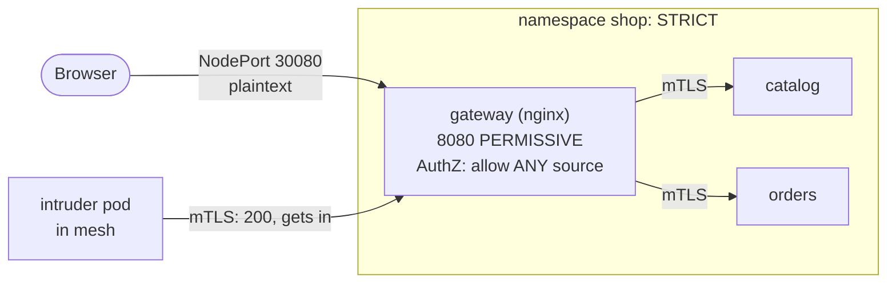
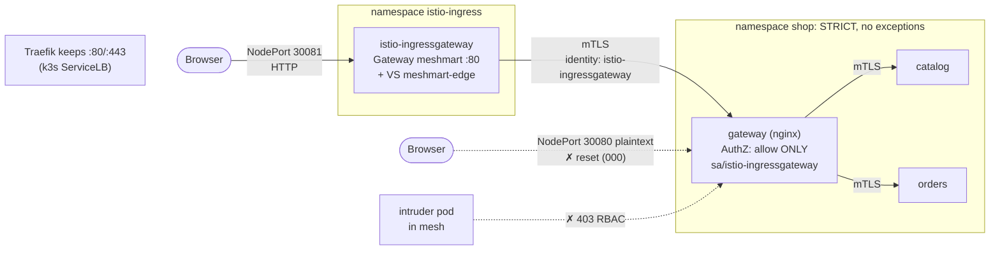

# Answers

Candidate: mr-anderson86
Date:
Time spent:

## Part 1 - Baseline

**Q1.1**
Roughly 50/50, and it moves randomly between runs (4 runs of 50: 25/25, 22/28, 28/22, 22/28).
The `catalog` Service selects only `app=catalog`, so both versions' pods are endpoints. kube-proxy
(iptables mode on k3s) picks a random endpoint per new connection, so the split follows the
number of ready pods, not the version. nginx has no upstream keepalive, so every request opens a
new connection and gets a fresh random pick.

For 10% to v2 with plain Kubernetes, scale replicas 9:1 (9 × v1, 1 × v2). The cost:
- traffic weight is coupled to replica count (1% needs 100 pods);
- capacity is wasted just to get the ratio;
- an HPA on either Deployment changes the ratio;
- the split is per connection and approximate;
- there is no header-based routing.

**Q1.2**
The intruder, in another namespace with no credentials, got full access:
- `curl payments.shop:8080/charge` → **HTTP 200**, with `"caller_identity": null` (the caller is unknown);
- Redis `INCR hacked` → `:9`, an integer reply, meaning the write succeeded (the key is at 9 after repeated runs).

The network is flat and nothing is authenticated or encrypted.

The Kubernetes-native control is a **NetworkPolicy** (default-deny ingress in `shop` plus allows by
pod and namespace selector; k3s enforces it with kube-router). Two things it can't do that Istio can:
1. **Cryptographic workload identity.** NetworkPolicy matches IPs and labels, and anyone who can
   create a pod can set any label. Istio authorizes on the ServiceAccount's SPIFFE identity, proven by mTLS.
2. **Encryption in transit and L7 rules.** NetworkPolicy encrypts nothing (audit finding #2) and only
   works at L3/L4. Istio adds mTLS and can allow or deny by HTTP method, path or header.

**Q1.3**
16/50 = **32%** of orders failed with **502**, which matches payments' `failRate: 0.3`. Orders returns
502 (Bad Gateway) whenever any downstream call fails.

Without a mesh, retries live in the application code of every caller (here `orders`), around its
HTTP client or in a shared client library. Across 50 microservices:
- the same logic is reimplemented in every language and framework, and the copies drift;
- tuning retries or timeouts needs a code change and a redeploy;
- there is no central view or retry budget, so retries stacked across layers can cause retry storms;
- every team must know which endpoints are safe to retry (`/charge` is not idempotent).

## Part 2 - Onboarding

**Q2.1**
`catalog-v1` now has:
- init containers: `istio-init`, and `istio-proxy` with `restartPolicy: Always`;
- containers: `catalog` only.

`istio-init` runs once and writes iptables rules so all pod traffic goes through Envoy (ports
15001 outbound and 15006 inbound). `istio-proxy` is the Envoy sidecar, run by `pilot-agent`.

The mechanism is a mutating admission webhook. istiod registers `istio-sidecar-injector`, whose
`namespace.sidecar-injector.istio.io` webhook matches namespaces labelled `istio-injection=enabled`.
The API server sends each new pod spec to istiod, which adds the containers before the pod is stored.
That's why the chart is unchanged, and why a `rollout restart` was needed: existing pods are never
changed.

`istio-proxy` is an init container because it is a Kubernetes **native sidecar**. It starts and
must be ready before the app container, so the app's first outbound calls work. It runs for the
pod's whole life and is stopped after the app on shutdown, so Jobs can complete. This avoids the
startup and shutdown races of the old two-regular-containers setup. It still counts in READY (2/2).

**Q2.2**
Yes. The intruder still gets HTTP 200 from payments (`caller_identity: null`) and can still
`INCR` Redis. Istio's default mTLS mode is **PERMISSIVE**: each sidecar accepts both mTLS and
plaintext. `istioctl x describe pod` shows "Workload mTLS mode: PERMISSIVE", and no
PeerAuthentication or AuthorizationPolicy exists yet. Onboarding adds encryption where both sides
support it but enforces nothing.

(Test artifact: `printf ... | nc -w 2` now returns nothing, because the sidecar drops a connection
whose client closes the moment it has sent. With stdin held open, `(printf 'INCR hacked\r\n'; sleep 3) | nc ...`
still returns `:1`. The counter restarted because Redis was restarted and keeps no data on disk.)

Gateway → catalog **is encrypted**. Both pods have sidecars, so the gateway's Envoy uses
**auto-mTLS** and opens an Istio mTLS connection. Evidence:
- `caller_identity` is now filled in; it comes from the client certificate, which only exists over mTLS;
- catalog's sidecar access log shows the requested server name `outbound_.8080_._.catalog.shop.svc.cluster.local`
  (Istio mTLS SNI), while the intruder's plaintext request in payments' log shows `-`;
- `istioctl proxy-config cluster deploy/gateway-v1 --fqdn catalog.shop.svc.cluster.local -o json`
  shows the transport socket matched on `tlsMode: istio`;
- Kiali shows a padlock on the edge (Part 3).

**Q2.3**
- Part 1: `null`.
- Now: catalog sees `spiffe://cluster.local/ns/shop/sa/gateway`, and inventory sees `spiffe://cluster.local/ns/shop/sa/catalog`.

The server-side Envoy completes the mTLS handshake. It then adds an `X-Forwarded-Client-Cert` header
with the client certificate's URI SAN to the request it passes to the app, and `app.py` reads the
`URI=` field. The certificate is issued by istiod's CA to each sidecar over SDS, based on the pod's
ServiceAccount token, and rotated automatically (24h TTL).

The format is a SPIFFE ID, `spiffe://<trust-domain>/ns/<namespace>/sa/<serviceaccount>`. The
identity belongs to the **ServiceAccount**, not to the pod, its IP or its labels.

**Q2.4**
`base` holds the cluster-wide pieces: the Istio CRDs, cluster roles and the default validating
webhook (`defaultRevision`). `istiod` is the control plane. It watches those CRDs, so they must
exist first. Their lifecycles also differ: CRDs are cluster-scoped and installed once, and they
are shared by every istiod revision, while control planes can run side by side and come and go.

They must share one version because CRD schemas, istiod and the proxies are released and tested
together. If base is older, istiod may write fields the CRDs don't know, and the validation webhook
may reject valid config. Mixed versions are unsupported. On upgrade, `base` goes first, since newer
CRDs are backward compatible.

Canary upgrade to the next minor version:
1. Upgrade `istio-base`.
2. Install a second control plane, e.g. `helm install istiod-1-32 istio/istiod --set revision=1-32`, next to the current one.
3. Use **revision tags**: `prod-stable` → old revision, `prod-canary` → new revision. Namespaces are
   labelled `istio.io/rev=prod-stable` instead of `istio-injection=enabled`.
4. Move a few namespaces to `prod-canary` and restart them, then watch errors and latency.
5. Point `prod-stable` at the new revision and restart the remaining namespaces gradually.
6. Remove the old istiod once no proxy uses it. To roll back, point the tag back and restart.

Proxies only change version when pods restart, so the pace is controlled one namespace at a time,
and namespace labels never need editing.

## Part 3 - Observability

**Q3.1**
Every edge between workloads in `shop` has a padlock: gateway → catalog/orders, catalog → inventory,
orders → payments, and orders → redis (TCP). Both ends have a sidecar, so the client Envoy uses
auto-mTLS with istiod-issued certificates.

The only edge without one is `unknown → gateway`: the browser or `load.sh` coming in through the
NodePort. The caller is outside the mesh, with no sidecar and no certificate, so it can only send
plaintext. The gateway's sidecar accepts it because the namespace is still PERMISSIVE. Kiali shows
the source as `unknown` because no sidecar on the client side reports its identity.

**Q3.2**
About **30%** (Kiali: 29.97% inbound 5xx; Prometheus: 30.0% over 5m), matching `failRate: 0.3`.

The numbers come from the **Envoy sidecars**, not the app. Every sidecar records Istio's standard
metrics (`istio_requests_total`, `istio_request_duration_milliseconds`, `istio_tcp_*`) for each
request it handles, labelled with source and destination workload, identity and response code. Both
the client (`reporter="source"`) and server (`reporter="destination"`) proxies report.

Envoy exposes them on `:15020/stats/prometheus`, Prometheus scrapes them through the PodMonitor, and
Kiali and Grafana query Prometheus. Payments' sidecar shows `response_code="500"` 1518 vs `"200"`
3485 from `orders-v1`. No code changes were needed.

**Q3.3**
Target health shows one `envoy-stats-monitor` target per meshed pod, all `UP`, scraped at
`http://<podIP>:15020/stats/prometheus`. The discovered `__address__` is `<podIP>:15090`, the only
port `istio-proxy` declares (`http-envoy-prom`). It serves Envoy's stats only.

15020 is pilot-agent's **merged** endpoint: Envoy stats plus `istio_agent_*` plus the application's
own metrics. With Istio's metrics merging (`enablePrometheusMerge`, default on), the injector sets
`prometheus.io/scrape|port|path=true|15020|/stats/prometheus` on the pod, moves any app annotations
into `ISTIO_PROMETHEUS_ANNOTATIONS`, and pilot-agent scrapes and merges the app. That gives one target
per pod, and it still works under STRICT mTLS, where Prometheus can't reach the app port directly.

15020 is never a declared container port, so a port-name endpoint can't select it. The relabeling
keeps only the `istio-proxy` container and pods with `prometheus.io/scrape`, then builds
`__address__` from pod IP + `prometheus.io/port`, with an IPv6 variant using `[ip]:port`.

## Part 4 - Zero trust

**Q4.1**
With namespace-wide STRICT ([`00-peerauthentication.yaml`](istio/00-peerauthentication.yaml)), the UI
broke: the browser and curl got an empty response (`HTTP 000`, `ERR_EMPTY_RESPONSE`). The browser is
outside the mesh and can't present a mesh certificate, so it reaches the gateway over plaintext
through the NodePort. The gateway's sidecar now accepts only mTLS and resets the connection: its
access log shows `NR filter_chain_not_found`. The intruder gets the same result against payments,
Redis and every other service, which is the point.

Fix: a workload-scoped PeerAuthentication
([`01-peerauthentication-gateway.yaml`](istio/01-peerauthentication-gateway.yaml)) selects
`app=gateway`, keeps `mode: STRICT`, and sets `portLevelMtls` to `PERMISSIVE` for **container port
8080 only** (the targetPort the sidecar sees, not Service port 80 or NodePort 30080). The most
specific policy wins per workload, so only that one port on the gateway accepts plaintext. Every
other workload keeps the namespace STRICT policy, which `istioctl x describe pod` confirms.
PERMISSIVE rather than DISABLE keeps mTLS working for any future in-mesh caller, such as an ingress
gateway.

Trade-off: gateway:8080 accepts plaintext from any pod in the cluster, so the gateway can act on
behalf of an un-meshed caller. Part 4.2's AuthorizationPolicies limit what the gateway itself may
call. The clean fix is an Istio ingress gateway that ends TLS at the edge (B3), so the nginx gateway
can go back to fully STRICT.

**Q4.2**
Policies: default deny ([`10-authz-deny-all.yaml`](istio/10-authz-deny-all.yaml)) plus one ALLOW per
receiving workload ([`11`](istio/11-authz-gateway.yaml) to [`16`](istio/16-authz-redis.yaml)). Each
allow names the caller's principal and the port, method and path it may use. The gateway allow has no
principal because the browser has no identity.

Istio's workload identity **is** the ServiceAccount: each sidecar's certificate carries
`spiffe://cluster.local/ns/<ns>/sa/<sa>`, and that is what `source.principals` matches. Because
every workload has its own SA, each caller has a distinct, cryptographically verified identity, so
policies can express the matrix exactly: `sa/orders` may call payments, `sa/gateway` may not.

If every pod used `default`, every caller in `shop` would present the same principal,
`cluster.local/ns/shop/sa/default`. Policies couldn't tell callers apart. Allowing orders → payments
would also allow gateway → payments, catalog → payments and so on, so the direct buttons couldn't be
denied. The best you could do is "anything in `shop` may call anything in `shop`", namespace-level
trust instead of least privilege. It also widens the blast radius: compromising any one pod gives an
attacker the identity, and any Kubernetes RBAC rights, of all of them. (Per-version SAs aren't needed:
catalog v1 and v2 share `sa/catalog` because they play the same role.)

**Q4.3**
In 4.1 the intruder had no sidecar, so it spoke plaintext. Payments' and Redis's sidecars, under
STRICT PeerAuthentication, reset the connection before any HTTP: curl got `HTTP 000` (exit 56), nc
got nothing, and Envoy logged `NR filter_chain_not_found`. That's the **authentication / transport
layer**.

After joining the mesh, the intruder has a valid istiod-issued certificate for
`spiffe://cluster.local/ns/intruder/sa/default`, so the mTLS handshake **succeeds**. It is now
stopped by **authorization**: payments returns **`403 RBAC: access denied`**, logged as
`rbac_access_denied_matched_policy[none]`, because default-deny is in place and no ALLOW rule lists
`ns/intruder/sa/default`. For Redis (TCP) the same RBAC check runs in Envoy's network filter. With no
HTTP there's no 403, so the connection is just closed after the handshake (empty reply, same log
reason).

| | **4.1**: intruder **not** in the mesh | **4.3**: intruder **in** the mesh |
|---|---|---|
| Payments | `HTTP 000`, connection reset | `HTTP 403 RBAC: access denied` |
| Redis | Empty reply (connection reset) | Empty reply (connection closed after mTLS) |
| Envoy reason | `NR filter_chain_not_found` | `rbac_access_denied_matched_policy[none]` |
| Blocking layer | **Authentication, at TLS/L4:** PeerAuthentication STRICT, no client cert | **Authorization, at L7 (HTTP) or L4 (TCP):** AuthorizationPolicy, identity not allowed |

The lesson: mTLS proves identity, but every meshed workload gets one, so authorization policies are
what enforce least privilege.

**Q4.4**
No. Istio only parses HTTP/gRPC. Redis's RESP is treated as opaque TCP, so an AuthorizationPolicy
for Redis can only match L4 attributes: source principal, namespace or IP, and destination port.
HTTP-only fields like `methods` or `paths` don't apply; Istio drops such an ALLOW rule or widens a
DENY rule rather than inspecting commands. `INCR` and `FLUSHALL` are just bytes in the stream.

What Istio *can* enforce is already in place: only `cluster.local/ns/shop/sa/orders` may connect to
Redis on 6379 ([`16-authz-redis.yaml`](istio/16-authz-redis.yaml)). Once connected, orders could
still send any command.

Restricting *commands* must happen in Redis itself, with Redis 6+ ACLs. `app.py` sends no `AUTH`, so
it runs as the built-in `default` user, which can be limited with
`ACL SETUSER default on nopass -@all +incr +ping ~*` (`PING` is kept for the readiness probe).
`FLUSHALL` then fails with `NOPERM`. If the app could send `AUTH`, a dedicated `orders` user with a
password from a Secret would be better.

Verified at runtime (not persisted: this Redis has no ACL file and runs with `--save ""`, so the rule
is lost when the pod restarts):

```console
$ kubectl -n shop exec deploy/redis-v1 -c redis -- redis-cli ACL SETUSER default on nopass -@all +incr +ping '~*'
OK

$ kubectl -n shop exec deploy/orders-v1 -c orders -- sh -c "(printf 'INCR orders-test\r\n'; sleep 2) | nc -w 3 redis 6379"
:1

$ kubectl -n shop exec deploy/orders-v1 -c orders -- sh -c "(printf 'FLUSHALL\r\n'; sleep 2) | nc -w 3 redis 6379"
-NOPERM User default has no permissions to run the 'flushall' command
```

Both commands from orders go through the mesh (orders' sidecar → mTLS → Redis's sidecar), so Istio
allows the connection and the Redis ACL alone refuses `FLUSHALL`. The order counter survived and kept
increasing. The same test from the intruder gets an empty reply: Istio closes the connection before
Redis sees any command.

In production I'd make this declarative in the Helm chart instead of a manual `ACL SETUSER`, since
the Redis args are hard-coded in `templates/redis.yaml` today. Two options:
- a value with the ACL rules themselves, e.g. `redis.aclRules: ["on", "nopass", "-@all", "+incr", "+ping", "~*"]`,
  rendered into the Redis args as `--user default ...`;
- a value like `redis.aclConfigMaps` naming ConfigMaps that contain `users.acl` files, mounted into
  the pod and loaded with `--aclfile`. This scales better to several users, and passwords would come
  from a Secret.

Istio controls who connects; Redis controls what they may run.

**Q4.5**
Yes: `curl localhost:9000/charge` returns 200 with `caller_identity: null`, and payments' sidecar
logs nothing for it. Port-forward doesn't go over the pod network: kubectl → API server → kubelet,
which opens the connection **inside the pod's network namespace to 127.0.0.1:8080**. Istio's iptables
only redirect traffic arriving on the pod's interface to Envoy (port 15006), so this connection goes
straight to the app and skips the sidecar entirely: no mTLS, no PeerAuthentication, no
AuthorizationPolicy. (`svc/payments` just picks a pod; no Service routing is involved.)

This is also why Part 4 behaves differently over port-forward: forwarding to the gateway bypasses its
sidecar, so STRICT would not have broken the UI.

The only check is Kubernetes RBAC on `create pods/portforward`. That permission is effectively a
bypass around every mesh policy in the namespace, so it should be treated like admin: only
break-glass or on-call operators, time-limited, audited via API server audit logs, never CI or
application service accounts in production. The same applies to `pods/exec`, `pods/attach` and
`create pods`, since a new pod can run as any ServiceAccount in the namespace and take on its identity.

RBAC is additive (there are no deny rules), and the built-in `edit` and `admin` ClusterRoles grant
`pods/portforward`, `pods/exec` and `pods/attach`. So developers and CI shouldn't get `edit`, but a
custom deploy role without those subresources, and port-forward should be a separate role bound only
to an on-call group. Example implementation (not applied):
[`examples/shop-roles.yaml`](examples/shop-roles.yaml).

## Part 5 - Traffic management

**Q5.1**
Two resources:
- A **DestinationRule** ([`20-catalog-destinationrule.yaml`](istio/20-catalog-destinationrule.yaml))
  defines the subsets `v1` and `v2` of `catalog.shop.svc.cluster.local` by the `version` label. Each
  subset becomes its own Envoy cluster (`outbound|8080|v1|catalog...`). It's also where
  per-destination policy (load balancing, connection pool, outlier detection, TLS) would live. There's
  no `tls` override, so auto-mTLS keeps working under STRICT.
- A **VirtualService** ([`21-catalog-virtualservice.yaml`](istio/21-catalog-virtualservice.yaml))
  holds the routing rule for requests addressed to the catalog host: weight 90 to subset `v1`, 10 to
  `v2`. For each request Envoy does an independent weighted random pick, so the split no longer
  depends on replica counts. 200 requests gave 182 v1 / 18 v2.

The decision is made by the **caller's** sidecar: for UI traffic, the **gateway pod's Envoy**
(outbound). It applies the VirtualService, picks the subset, load-balances to one pod and connects to
that pod IP directly over mTLS. `istioctl proxy-config routes deploy/gateway-v1 --name 8080` shows the
weighted clusters (90/10). Catalog's own sidecar only enforces inbound security and records telemetry.
A caller without a sidecar wouldn't get the split at all; it would go through kube-proxy and get the
~50/50 from Part 1.

**Q5.2**
[`21-catalog-virtualservice.yaml`](istio/21-catalog-virtualservice.yaml) now has two HTTP routes,
checked top to bottom (first match wins): `canary-header` matches `x-canary: exact: always` and sends
100% to subset `v2`; everything else falls through to `weighted-split` (90/10). The header route must
come first, or the catch-all split would take every request. Result: 20/20 v2 with the header, 191 v1 /
9 v2 out of 200 without it. `istioctl proxy-config routes <gateway-pod> --name 8080 -o json` shows both
routes in that order.

Hop by hop:
1. **Browser → gateway pod.** The UI's JavaScript adds `x-canary: always` to its request. The gateway's
   inbound Envoy (port 8080, PERMISSIVE) passes the request to nginx unchanged; inbound sidecars don't
   route between versions.
2. **nginx → catalog.** nginx is a reverse proxy and by default copies the client's request headers
   onto the upstream request (only `Host` and, in this config, `Connection` are rewritten), so its new
   request to `catalog:8080/products` still carries `x-canary`.
3. **Gateway's outbound Envoy.** iptables sends nginx's outgoing request through the gateway pod's own
   sidecar. **This is where routing happens**: that Envoy evaluates the catalog VirtualService, sees the
   header, and picks a v2 pod. Catalog's sidecar only receives the result.

**catalog → inventory.** This hop is a brand-new HTTP request that the catalog *application* builds.
Envoy can't carry headers over from the inbound request: it sees two separate connections and doesn't
know which outgoing call was triggered by which incoming request. Only the app knows, which is why
`app.py` copies the `PROPAGATE` list (`x-canary`, `x-request-id`, `traceparent`, `b3` ...) onto its
downstream calls. If it didn't:
- Catalog's outbound Envoy would see an inventory request **without** `x-canary`. Today nothing breaks,
  because inventory has only v1 and no VirtualService. But once inventory gets its own canary with the
  same header rule, a tester would get catalog v2 with inventory **v1** (from the default split). That's
  a mixed version path, so the test isn't really exercising v2 end to end.
- For the same reason, distributed tracing would break: without `traceparent`/`b3`/`x-request-id` each
  hop would start a new trace, instead of one trace across gateway → catalog → inventory.

Header-based routing (and tracing) in a mesh only works end to end if every service in the chain
propagates the headers. The sidecar does the routing, but it relies on the app to pass the context on.

**Q5.3**
**Where:** in a VirtualService for the payments host,
[`30-payments-virtualservice.yaml`](istio/30-payments-virtualservice.yaml). Like all VirtualService
rules, it is executed by the **caller's** sidecar: the **orders pod's outbound Envoy** retries, and
neither the orders app nor payments is changed. The orders app only sees the final response.

**Conditions:**
- `retryOn: 5xx,reset,connect-failure`: retry on any 5xx response, on a connection reset, or when the
  connection can't be opened.
  - `5xx` is the one that matters here. Istio's default retry policy doesn't cover a plain HTTP 500,
    which is what payments returns, so without it the baseline stays at ~70%.
- `attempts: 3`: up to 4 tries in total. An order fails only if all 4 fail: 0.3⁴ ≈ 0.8%.
- `perTryTimeout: 1s`: a hung attempt is abandoned after 1s and retried, so a stuck call can't use up
  the app's own 3s timeout.

**Result:** before, `tools/load.sh /api/orders 100 5` gave 70 × 200 / 30 × 502. After: 100/100, and
297/300 in a longer run (1%, as expected). Orders' Envoy counters
(`kubectl exec deploy/orders-v1 -c istio-proxy -- pilot-agent request GET clusters`, payments cluster)
show the hidden work: over 100 orders, `rq_total` went up by **140** and `rq_error` by **40**. Payments
failed 40 attempts, Envoy retried each one, and all 100 orders succeeded.

**The danger:** a retry is safe only if doing the operation twice has the same effect as doing it once
(idempotent). A charge isn't, by default:
- A 500 or a timeout doesn't mean "nothing happened". Payments may have charged the card and then
  failed while writing the response, or answered after `perTryTimeout` expired. Envoy can't tell the
  difference and retries, so the customer is **charged twice** (or up to 4 times here).
- Retries also multiply load. If payments is failing because it's overloaded, up to 4× the requests
  make it worse (a retry storm). Retries at several layers multiply each other.

**What payments must guarantee:** **idempotency**. The client sends a unique **idempotency key** per
logical payment (for example the order ID, in a header such as `Idempotency-Key`), and payments stores
the key with the result. A repeated request with the same key returns the stored result instead of
charging again. That also requires the key to be propagated on every hop, like `x-canary`. Without
that guarantee, retries on a charge should be limited to failures where the request certainly never
reached the service (`connect-failure`, `refused-stream`), not `5xx`. Here, `5xx` retries are
acceptable only because the demo's failures are simulated before any "charge" happens.

**Q5.4**
Files:
- [`40-inventory-virtualservice.yaml`](istio/40-inventory-virtualservice.yaml) (final state): `timeout: 1s`
  on calls to inventory.
- [`experiments/inventory-fault.yaml`](istio/experiments/inventory-fault.yaml) (not applied by the
  grader): the same VirtualService name with `fault.delay.fixedDelay: 4s` at 100%, plus the same
  timeout. Istio doesn't reliably merge two VirtualServices for one host, so the two files share a
  name and applying either one replaces the other.

**Delay only (step 1):** *Browse catalog* returned **502 after ~3s**, not 4s. The inventory call shows
`"status": 0, "ms": 3002, "error": "TimeoutError: timed out"`. Catalog's own code gave up first
(`urlopen(..., timeout=3)` in app.py). `status 0` is the app's notation for "no HTTP response at all".
Catalog's sidecar logged `0 DI,DC downstream_remote_disconnect ... 3006`, meaning delay injected and
the catalog app hung up. **Inventory's sidecar logged nothing:** the request never left the catalog pod.

**Delay + timeout (both applied):** exactly the same, **status 0 after ~3s**. The 1s timeout never
fires, although `istioctl proxy-config routes <catalog-pod>` shows both `timeout: 1s` and
`fixedDelay: 4s` on the inventory route. The Istio VirtualService reference documents this for
`HTTPRoute.fault`: *"timeouts or retries will not be enabled when faults are enabled on the client
side."* Inside Envoy, the fault step holds the request for 4s before it reaches the forwarding step,
and the timeout timer belongs to the forwarding step. With sidecars, the fault and the timeout for one
host always end up on the same route of the same (caller's) Envoy, so the fault can't be used to
demonstrate this timeout.

**Timeout with real slowness:** to see the timeout work, the fault was removed
(`kubectl apply -f istio/40-inventory-virtualservice.yaml`) and inventory itself was made slow for
one test (`kubectl set env deploy/inventory-v1 -n shop DELAY_MS=4000`, reverted afterwards to `0`, the
chart's value):
```
{"target": "http://inventory:8080/stock", "status": 504, "ms": 1005, "error": "upstream request timeout"}
502 in 1.011965s
```
Catalog's sidecar logged `504 UT response_timeout ... 1000`. Catalog now fails fast in **1s with a
504** for its inventory call (the body is written by Envoy, not inventory) instead of waiting 3s.

**Which Envoy:** **both are catalog's sidecar** (the caller, outbound), like every VirtualService
rule. It injected the delay (`DI`) before anything was sent, and it runs the 1s timer and returns the
504 (`UT`). Inventory's sidecar applies neither. It only sees the request if the delay lets it through.

Final state: the fault is only in `istio/experiments/`. Inventory runs its original Helm ReplicaSet
(`DELAY_MS=0`), `kubectl diff -f istio/` shows no drift, and `tools/check.sh` passes 9/9.

## Written questions

**W1**
**Roles.** `istiod` is the **control plane** and never handles a request. It has three jobs:
- **Config server (xDS):** it watches the Kubernetes API (Services, endpoints, VirtualServices,
  AuthorizationPolicies...), translates everything into Envoy config and pushes it to every sidecar.
  `istioctl proxy-status` shows each pod subscribed to CDS/LDS/EDS/RDS.
- **CA:** it signs each workload's SPIFFE certificate (pilot-agent sends a CSR, istiod returns the cert).
- **Sidecar injector:** it's the mutating webhook that adds `istio-proxy` to new pods.

**Envoy** is the **data plane**. Every request goes through it: mTLS, routing and weights, retries and
timeouts, AuthorizationPolicy, and metrics.

**istiod down for 10 minutes:**
- **Existing traffic keeps working.** Each Envoy keeps its last config and its current certificate in
  memory, so mTLS, routing, retries and authz carry on. What stops is **change**:
  - new or edited VirtualServices and AuthorizationPolicies aren't pushed;
  - neither are endpoint changes. A pod that dies or moves to a new IP stays in every sidecar's list,
    and replacement pods are never added. Retries and outlier detection soften this, but the mesh
    is working from a frozen copy of the config.
- **New pods can't be created** in injected namespaces. The injector webhook here has
  `failurePolicy: Fail`, so the API server rejects pod creation in `shop` while istiod is unreachable.
  Scale-ups, rollouts and replacements for crashed or evicted pods all stall. A pod that was already
  injected can't get its config or certificate either: its `istio-proxy` never gets ready, and as a
  native sidecar it holds back the app container.
- **Certificate rotation isn't affected.** Workload certs last 24h
  (`istioctl proxy-config secret`: NOT BEFORE 2026-11-10T12:57, NOT AFTER 2026-11-11T12:59) and
  pilot-agent renews them at about 50% of their lifetime. A missed renewal is retried while the current
  cert stays valid for hours. mTLS only breaks if istiod stays down longer than the remaining validity.

In production, `istiod` needs:
- at least 2 replicas;
- a PodDisruptionBudget, so planned drains never evict all replicas at once;
- `topologySpreadConstraints` (or pod anti-affinity) across nodes and zones, so one node or zone failure
  can't take every replica.

The istiod chart supports all three. This lab runs a single replica with no PDB on a single node, so
draining that one node is enough to cause exactly this scenario.

**W2**
The end state is one line (a `PeerAuthentication` with `mode: STRICT`, plus documented exceptions
like the gateway's port-level PERMISSIVE in 4.1). The risk is in the switch itself. STRICT only changes
the **receiver**: callers with a sidecar already send mTLS in PERMISSIVE (auto-mTLS) and don't notice,
but any caller that can't do mTLS is cut off the moment the policy lands. With 50 services you have
to find those callers first:
- pods in non-injected namespaces or opted out with `sidecar.istio.io/inject: "false"`
- Jobs and CronJobs (they may run only weekly), `hostNetwork` pods, VMs, clients outside the cluster
- traffic arriving over a NodePort or LoadBalancer with no ingress gateway (the browser → gateway case
  in 4.1)
- monitoring that scrapes application ports from outside the mesh
- DestinationRules with `tls.mode: DISABLE`, which force plaintext even between two sidecars
- the same applies to TCP services (databases, Redis), not only HTTP

**Plan:**
1. **Measure while still PERMISSIVE.** Every Envoy labels incoming traffic with
   `connection_security_policy` (`mutual_tls` or `none`). Per destination:
   `sum by (source_workload, destination_workload, connection_security_policy)
   (istio_requests_total{reporter="destination"})`, plus `istio_tcp_connections_opened_total` for TCP.
   Each `none` row is a caller STRICT would break. In this lab, the query shows every internal edge as
   `mutual_tls` and only `unknown -> gateway-v1 none` (the browser), which is exactly what broke in
   4.1. Kiali shows the same thing: no padlock on an edge means plaintext. Look at a window long enough
   to include batch jobs.
2. **Fix the callers:** inject them, remove `tls: DISABLE`, put an ingress gateway in front of external
   entry points. Repeat until each destination shows zero `none`.
3. **Switch to STRICT step by step:** one low-risk workload (PA with a `selector`), then one namespace,
   then the next, and mesh-wide (PA in `istio-system`) only at the end. Leave critical and
   ingress-facing services for last.
4. **Exceptions only where unavoidable:** use workload or port-level PERMISSIVE, documented, with an
   owner and a plan to remove it.
5. **Rollback is instant:** delete the PA or set it back to PERMISSIVE. Keep that ready for every
   step.

**What to watch after each step:**
- `connection_security_policy="none"` stays at zero for the destinations just switched.
- Destination error rate: 5xx, connection resets, Kiali edges turning red.
- Envoy access logs with `NR filter_chain_not_found` (a plaintext connection refused, as seen in 4.1).
- Errors reported by the **unmeshed callers**. Their failed connections never reach Istio's request
  metrics, so check their own logs and alerts too.

**W3**
By default nginx's `proxy_pass` talks **HTTP/1.0** to its upstream. With a sidecar, that upstream is the
gateway pod's own outbound Envoy, which only treats HTTP/1.1 and HTTP/2 as HTTP.

The outbound listener on port 8080 uses `http_inspector` to look at the first bytes, then picks a filter
chain (`istioctl proxy-config listeners <gateway-pod> --port 8080 -o json`):
```
{"match": {"applicationProtocols": ["http/1.1", "h2c"]}, "filters": ["http_connection_manager"]}
defaultFilterChain: PassthroughFilterChain
```
Only `http/1.1` and `h2c` reach the HTTP connection manager, which is where VirtualService routing,
retries, timeouts, mTLS identity, AuthorizationPolicy matching on HTTP fields and HTTP metrics live. An
HTTP/1.0 request falls through to the **passthrough** chain. Envoy then forwards the raw bytes as TCP to
the original IP, in **plaintext**.

Tested from the nginx container (`kubectl exec deploy/gateway-v1 -c nginx -- curl --http1.0 / --http1.1
http://catalog:8080/products`):
```
HTTP/1.0 request -> 000   (Recv failure: Connection reset by peer)
HTTP/1.1 request -> 200
```
The gateway's Envoy logged the 1.0 attempt as plain TCP to the passthrough cluster, reset by the upstream:
`"- - -" 0 UR ... PassthroughCluster ... 10.43.232.218:8080`. Catalog is STRICT, so the plaintext
connection is reset. Without `proxy_http_version 1.1`, every UI request would fail with a 502.

Under PERMISSIVE it would have looked fine, which is worse. Requests would arrive as anonymous plaintext
TCP that bypasses the mesh entirely:
- no canary or header routing (5.1/5.2)
- no retries or timeouts (5.3/5.4)
- no HTTP metrics or Kiali edges
- no SPIFFE identity, so catalog's AuthorizationPolicy (principal `sa/gateway`) would deny it

Even when Envoy does parse a request as HTTP/1.0, it rejects it by default with `426 Upgrade Required`,
unless HTTP/1.0 support is explicitly enabled in Istio.

`proxy_set_header Connection ""` goes with it: in HTTP/1.0 mode nginx sends `Connection: close`, and
clearing that header lets the connection to Envoy stay open (HTTP/1.1 keep-alive).

**W4**
**Resources.** Every pod runs a full Envoy next to the app:
```
$ kubectl top pod -n shop --containers
POD            NAME          CPU   MEMORY
catalog-v1     catalog       1m    32Mi      istio-proxy  4m   48Mi
inventory-v1   inventory     1m    15Mi      istio-proxy  4m   47Mi
orders-v1      orders        1m    16Mi      istio-proxy  3m   46Mi
gateway-v1     nginx         1m    17Mi      istio-proxy  3m   49Mi
payments-v1    payments      1m    14Mi      istio-proxy  3m   120Mi
redis-v1       redis         10m   38Mi      istio-proxy  3m   45Mi
$ kubectl top pod -n istio-system
istiod   3m   178Mi        kiali   2m   153Mi
```
- In every pod the sidecar uses more memory than the app itself (~3× for these small apps). Across 7
  sidecars that's ~400Mi, against ~150Mi for all the apps together.
- Payments' 120Mi isn't a heavier Envoy. In `/sys/fs/cgroup/memory.stat` its `anon` memory (~45MB) is
  the same as every other sidecar. The extra ~78MB is page cache of the shared `envoy` and `pilot-agent`
  binaries, which Linux bills to the first cgroup that loaded them: `file_mapped` is 45MB in payments
  and 0 in orders. The real per-sidecar cost is ~45–50Mi. Per-container `kubectl top` can include
  shared cache like this, but memory limits count it all the same.
- On top of that come the control plane and add-ons (istiod, Kiali, Prometheus).
- Requests matter too. This lab lowered the sidecar request to `10m/40Mi` (`global.proxy.resources`), but
  Istio's default is `100m/128Mi` **per pod**. The scheduler reserves that whether it's used or not:
  ~100 cores and ~125Gi for proxies at 1000 pods.

**Latency.** Every call crosses two Envoys (the caller's outbound and the receiver's inbound) plus an
mTLS handshake and encryption. That's usually ~1–3 ms per hop. Measured here with 100 sequential
requests each way:
```
P='import sys,time,statistics,urllib.request as u
t=[]
for _ in range(100):
    s=time.perf_counter(); u.urlopen(sys.argv[1]).read(); t.append((time.perf_counter()-s)*1000)
print(f"p50 {statistics.median(t):.1f}ms")'
kubectl exec -n shop deploy/inventory-v1 -c inventory -- python3 -c "$P" http://localhost:8080/stock   # p50 0.4ms  (no sidecar in path)
kubectl exec -n shop deploy/catalog-v1   -c catalog   -- python3 -c "$P" http://inventory:8080/stock   # p50 43.0ms (2 sidecars + mTLS)
```
The extra ~40 ms isn't Envoy processing time. Inventory's inbound access log shows where it comes from:
```
$ kubectl logs -n shop deploy/inventory-v1 -c istio-proxy --tail=3
"GET /stock HTTP/1.1" 200 - via_upstream ... 0 176 40 0 ... inbound|8080|| 127.0.0.6:34793 ...
```
- Total duration 40 ms, but upstream service time (first bytes from the app) is **0 ms**: the app answers
  instantly and the rest of the response arrives ~40 ms later.
- The same upstream connection (`127.0.0.6:34793`) is reused for every request. Envoy keeps the connection
  to the app open.
- `app.py` writes the headers and the body as two separate small writes (`end_headers()`, then
  `wfile.write(body)`). On a reused TCP connection, Nagle's algorithm holds back the second small segment
  until the first is ACKed, and the receiver's delayed ACK waits ~40 ms.
- Without the sidecar every request was a new connection, which ACKs immediately, so the problem never
  showed. (The fix belongs in the app, e.g. one write or `TCP_NODELAY`, and app.py is off-limits here.)

So the sidecar changes connection behaviour, and here it exposed a latent app issue that took
access-log analysis to find. That's an operations cost as much as a latency one.

**Operations.**
- **Another layer to debug.** Envoy response flags, `istioctl proxy-config`, iptables redirection. In this
  exam alone:
  - STRICT broke the UI (`NR filter_chain_not_found`, 4.1)
  - nginx's HTTP/1.0 was silently passed through as plaintext TCP (W3)
  - a fault silently disabled the route timeout (5.4)
  - port-forward bypasses every policy (4.5)
  - `printf | nc` against Redis gave false results through the sidecar

  The tools for this:
  ```
  istioctl proxy-config listeners|routes|clusters|secret <pod>     # what Envoy actually loaded
  kubectl logs <pod> -c istio-proxy                               # flags: NR, UR, UT, DI, DC, URX ...
  ```
- **Upgrades restart every pod.** The proxy image is fixed at injection time, so a new Istio version only
  reaches a workload when its pod is recreated. That needs revisions or canary upgrades for safety.
  ```
  $ kubectl get pods -n shop -o jsonpath='{range .items[*]}{.metadata.name}{"  "}{.spec.initContainers[?(@.name=="istio-proxy")].image}{"\n"}{end}'
  catalog-v1-...  docker.io/istio/proxyv2:1.31.3        (one per pod)
  $ istioctl version
  control plane version: 1.31.3
  data plane version: 1.31.3 (8 proxies)
  ```
- **The control plane becomes critical (W1).** Every proxy takes its config from istiod, and pod creation
  in injected namespaces depends on its webhook:
  ```
  $ istioctl proxy-status            # every pod subscribed to istiod for CDS/LDS/EDS/RDS
  $ kubectl get mutatingwebhookconfiguration istio-sidecar-injector -o jsonpath='{.webhooks[*].failurePolicy}'
  Fail Fail Fail Fail
  ```
  One bad VirtualService or AuthorizationPolicy can break traffic mesh-wide.
- **More API surface to learn and govern:** `kubectl get crd -o name | grep -c istio.io` gives **15**
  CRDs.
- **Pod lifecycle quirks:** startup ordering (the app must not call out before the proxy is ready), and
  Jobs that never complete because the sidecar keeps running. Native sidecars (an init container with
  `restartPolicy: Always`, used here) fix both, but only on recent Kubernetes.

**When not to adopt a mesh:**
- **A few services or a monolith.** The fixed costs above outweigh the benefits.
- **No team to own it.** A mesh is a platform with upgrades, a CA, debugging and policy to maintain.
- **No real need for what it offers.** If mTLS and identity, L7 traffic control and uniform telemetry
  aren't actual requirements, simpler tools cover them: NetworkPolicy, TLS in the app or a library, a
  cloud load balancer, retries in the HTTP client.
- **Very latency-sensitive paths** (trading, real-time) or tight resource budgets (edge, small clusters).
- **Mostly non-HTTP traffic** (databases, custom TCP). Istio is limited to L4 there; it couldn't restrict
  Redis commands in 4.4.
- **Middle ground:** Istio **ambient mode** replaces per-pod sidecars with a per-node L4 proxy (ztunnel)
  plus optional per-service waypoint proxies for L7. That removes most of the per-pod resource cost and
  the pod restarts on upgrade.

**W5**
The receiving workload's Envoy evaluates each request in this order:
1. **CUSTOM:** if a CUSTOM policy matches and the external authorizer (an `extensionProvider` such as
   OPA or oauth2-proxy) rejects it → **deny**.
2. **DENY:** if any DENY policy matches → **deny**.
3. If the workload has **no ALLOW policies at all** → **allow**.
4. **ALLOW:** if any ALLOW policy matches → **allow**.
5. Otherwise → **deny**.

A deny always wins over an allow, so a DENY policy is a guardrail no ALLOW can override (e.g. "never
from namespace `intruder`"). (AUDIT policies only mark requests for logging and don't affect the
decision.)

**One ALLOW policy, a request that matches no rule: denied.** As soon as one ALLOW policy applies to a
workload, its default flips from "allow everything" (step 3) to "allow only what an ALLOW rule matches",
and everything else falls to step 5. HTTP gets `403 RBAC: access denied`, and a TCP connection is
closed.

Shown with inventory, which has a single ALLOW rule (`sa/catalog`, GET, `/stock`, port 8080):
```
gateway -> inventory /stock    : RBAC: access denied 403     (wrong identity)
catalog -> inventory /stock    : 200                         (matches the rule)
catalog -> inventory /admin    : RBAC: access denied 403     (right identity, wrong path)
```
Inventory's sidecar logs both denials as `403 - rbac_access_denied_matched_policy[none]`. `[none]` means
no policy matched, so this is the step-5 default deny, not an explicit DENY policy.

That's also how [`10-authz-deny-all.yaml`](istio/10-authz-deny-all.yaml) works. `spec: {}` isn't a
DENY policy but an **ALLOW policy with no rules**, which matches nothing.
`istioctl x authz check deploy/inventory-v1 -n shop` lists it as `ALLOW deny-all.shop` next to
`ALLOW inventory.shop`. Its only effect is to give every workload in `shop` at least one ALLOW policy,
which turns on default-deny everywhere. The per-service ALLOWs (11–16) then open exactly the calls
the app needs. A real `action: DENY` matching everything would block all traffic, and no ALLOW could
reopen it.

## Bonus (list what you did and where it lives)


**B1 Circuit breaking**
Lives in [`istio/experiments/payments-circuit-breaker.yaml`](istio/experiments/payments-circuit-breaker.yaml)
(not in `istio/`, see below). It's a DestinationRule for payments, enforced by the **caller's Envoy**
(the orders sidecar):
- `connectionPool`: `tcp.maxConnections: 1`, `http.http1MaxPendingRequests: 1`. Requests beyond one active
  plus one queued are rejected immediately.
- `outlierDetection`: `consecutive5xxErrors: 3`, `interval: 5s`, `baseEjectionTime: 15s`,
  `maxEjectionPercent: 100`. A pod that returns 3 consecutive 5xx is removed from the pool.

`tools/load.sh /api/orders 200 20`, before and after applying it:
```
retries only:        199 × 200,   1 × 502
with the breaker:      2 × 200, 198 × 502      (p50 58 ms vs 94 ms: failing fast)
```
Orders' access log (`kubectl logs deploy/orders-v1 -c istio-proxy | grep /charge | awk '{print $5,$6}' | sort | uniq -c`),
one line per request with its final outcome:
```
 201 200 -          successes (199 from the baseline run + 2)
 184 503 UH         no healthy upstream: the only payments pod was ejected
  14 503 UO         upstream overflow: connection pool full, rejected without calling payments
   1 500 URX        baseline: all 4 attempts failed, retry limit exceeded
```
Right after the burst, orders' Envoy reported the pod as ejected:
`pilot-agent request GET clusters` → `payments...:8080::health_flags::/failed_outlier_check`. Payments'
own sidecar log shows only `200` and `500` and **no 503 at all**: every `UO`/`UH` response was produced
locally by orders' Envoy without contacting payments.

**How retries and circuit breaking interact:**
- **Retries add load to the breaker.** One order can be up to 4 attempts, and each attempt takes a slot in
  the connection pool, so retries fill it sooner and cause more `UO`.
- **Retried failures count toward ejection.** Every failed attempt counts as a 5xx for
  `consecutive5xxErrors`. Retries to the same (only) pod reach 3 consecutive 5xx quickly, so the pod is
  ejected sooner.
- **After ejection, retries are useless.** With a single pod there's no other host to retry on, so every
  attempt ends in `UH`. The breaker turned 99% success (retries alone) into 1%.
- **Designed to complement each other with several replicas.** Istio's retries prefer a *different* host,
  and outlier detection keeps a broken pod out of rotation, so the retry lands on a healthy one.
  Outlier detection is meant to remove **one bad pod among many**. Applied to a single pod that is flaky
  but alive, it causes a full outage for `baseEjectionTime`, which grows on each repeat ejection.
- **In production:**
  - run several replicas and keep `maxEjectionPercent` below 100;
  - size the pool limits from measured capacity;
  - cap concurrent retries mesh-wide with `connectionPool.http.maxRetries`, a retry budget against retry
    storms.

That's also why the file stays in `istio/experiments/`: in the final state it would keep ejecting the one
payments pod and fail the resilience check. Undo: `kubectl delete -f istio/experiments/payments-circuit-breaker.yaml`.

**B2 Dashboards as code**
Lives in [`platform/kube-prometheus-stack-values.yaml`](platform/kube-prometheus-stack-values.yaml) and
[`platform/kiali-values.yaml`](platform/kiali-values.yaml).

*Before:* the four dashboards were imported by hand in Part 3. Grafana listed them in `General` with
`"provisioned": false`, stored only in Grafana's database, which in this chart is an `emptyDir`.
Recreating the pod or starting a fresh cluster loses them, and nothing recorded which revision was
imported.

*Grafana:* under `grafana:` in the kps values:
- `dashboardProviders` defines a file provider `istio` that loads `/var/lib/grafana/dashboards/istio` into a
  read-only **Istio** folder.
- `dashboards.istio` lists the four dashboards by `gnetId` with a **pinned `revision`**: 7639 → 340
  (Mesh), 7636 → 339 (Service), 7630 → 340 (Workload), 7645 → 339 (Control Plane).
- On every start, the chart's `download-dashboards` init container fetches
  `https://grafana.com/api/dashboards/<id>/revisions/<rev>/download`.
- `datasource: [{name: DS_PROMETHEUS, value: Prometheus}]` replaces the dashboards' `${DS_PROMETHEUS}`
  input with kps's default datasource. The panels themselves use a `${datasource}` variable that
  resolves to the default Prometheus.

Verified with `helm template` against the installed chart versions before upgrading. After
`helm upgrade kps ...`, the recreated Grafana pod came up with the **Istio** folder holding all four
dashboards as provisioned, with data once traffic flows. With load running, the Service dashboard shows
payments at ~8 req/s against ~5.7 req/s for orders: the extra requests are the 5.3 retries.

*Kiali:* `external_services.grafana` is enabled with:
- `internal_url: http://kps-grafana.monitoring:80`, used by the Kiali server to look up dashboards by
  title;
- `external_url: http://localhost:3000`, for the browser links (the README's port-forward);
- basic auth (lab credentials, as with `adminPassword`; in production a Grafana viewer token from a
  Secret).

Kiali's service and workload pages then show **View in Grafana** links that open the matching Istio
dashboard.

**Keeping revisions in step with Istio upgrades.** Istio's release automation publishes a new revision
of each dashboard for **every** Istio release, on every release branch, interleaved. On grafana.com, the
revision description names the version:
```
rev 340  Istio Mesh Dashboard version 1.31.3      ← pinned (installed Istio)
rev 344  Istio Mesh Dashboard version 1.31.4
rev 345  Istio Mesh Dashboard version 1.30.8
rev 347  Istio Mesh Dashboard version 1.32.0      ← "latest"
```
So the "latest" revision, which is what a manual import gives you, belongs to whichever Istio release
was published last, here 1.32.0 against an installed 1.31.3. Leaving out `revision` is no better: the
chart then downloads revision **1**. Dashboards query Istio metric names and labels, which can change
between versions. How to keep them in step:
- Pin the revisions whose description matches the installed Istio version (lookup:
  `curl -s https://grafana.com/api/dashboards/<id>/revisions | jq '.items[] | {revision, description}'`).
- Bump them **in the same change** that bumps `$ISTIO_VERSION` for `istio-base`/`istiod`, so Istio and
  its dashboards upgrade as one reviewed unit (Renovate or a small CI script can propose the PR).
- For clusters without internet access, or for an exact match: take the dashboard JSON from the Istio
  repo at the release tag (`manifests/addons/dashboards/`) and ship it as ConfigMaps labelled
  `grafana_dashboard: "1"`. The Grafana sidecar in this chart already watches that label in all
  namespaces (`sidecar.dashboards.enabled: true`, `searchNamespace: ALL`).

**B3 Istio ingress gateway**
The files are [`platform/istio-ingressgateway-values.yaml`](platform/istio-ingressgateway-values.yaml) and
[`istio/experiments/b3-ingress/`](istio/experiments/b3-ingress/):
- [`00-gateway.yaml`](istio/experiments/b3-ingress/00-gateway.yaml)
- [`01-virtualservice.yaml`](istio/experiments/b3-ingress/01-virtualservice.yaml)
- [`02-peerauthentication-gateway.yaml`](istio/experiments/b3-ingress/02-peerauthentication-gateway.yaml)
- [`03-authz-gateway.yaml`](istio/experiments/b3-ingress/03-authz-gateway.yaml)

*Design:*
- **Ingress gateway:** `istio/gateway` chart at the same `$ISTIO_VERSION` (1.31.3), release
  `istio-ingressgateway` in namespace `istio-ingress`. The release name gives the pods the label
  `istio: ingressgateway` and the ServiceAccount `istio-ingressgateway`, so the gateway's mesh identity
  is `cluster.local/ns/istio-ingress/sa/istio-ingressgateway`.
- **Traefik:** Rancher Desktop's Traefik already owns 80/443 through k3s ServiceLB, so the chart's
  default `LoadBalancer` Service would stay `<pending>`. The values file switches it to a **NodePort
  on 30081**, next to the old nginx NodePort 30080 (one replica and no HPA, sized for the lab). The
  alternatives were to disable Traefik or to put Traefik in front of the ingress gateway.
- **`Gateway` `meshmart`** (in `istio-ingress`): an HTTP listener on port 80 for pods labelled
  `istio: ingressgateway`. `hosts: "shop/*"` lets only VirtualServices from namespace `shop` attach to
  it.
- **`VirtualService` `meshmart-edge`** (in `shop`): bound only to `istio-ingress/meshmart`, not to
  `mesh`, so in-mesh traffic is unaffected. It routes everything to `gateway.shop:80`. nginx keeps
  serving the UI and its `/api/*` mapping, and the ingress gateway becomes the new front door.
- **02 and 03:** these use the **same names** as the graded
  [`01-peerauthentication-gateway.yaml`](istio/01-peerauthentication-gateway.yaml) and
  [`11-authz-gateway.yaml`](istio/11-authz-gateway.yaml), so applying them **replaces** the Q4.1
  exception:
  - nginx becomes plain STRICT, with no port-level PERMISSIVE;
  - the only caller nginx accepts is the ingress gateway's principal, for GET/HEAD on 8080, instead of
    "any source".
- **Why `experiments/`:** the grader's cluster has no ingress gateway and `check.sh` tests `:30080`, so
  these files stay outside the graded `istio/` folder.

*Before vs after.* Solid arrows are traffic that's allowed. Dotted arrows marked ✗ are traffic that's
blocked.

*Before (Q4.1):* the browser's plaintext goes straight into an app pod through a PERMISSIVE hole.



*After (B3):* plaintext ends at the edge proxy, and every hop inside the mesh is mTLS.



The Traefik box has no traffic arrow. It's there to show why the ingress gateway uses NodePort 30081
instead of 80/443.

*Commands, in order:*
```bash
# 0. Validate before touching the cluster: render the chart (labels, SA, NodePort 30081),
#    check 30081 is free, dry-run the manifests, and lint the result with the existing config.
helm template istio-ingressgateway istio/gateway --version 1.31.3 -n istio-ingress \
  -f platform/istio-ingressgateway-values.yaml
kubectl get svc -A -o jsonpath='{range .items[*]}{.spec.ports[*].nodePort}{"\n"}{end}' | grep 30081   # nothing
kubectl apply --dry-run=server -f istio/experiments/b3-ingress/01-virtualservice.yaml \
  -f istio/experiments/b3-ingress/02-peerauthentication-gateway.yaml -f istio/experiments/b3-ingress/03-authz-gateway.yaml
kubectl apply --dry-run=client -f istio/experiments/b3-ingress/00-gateway.yaml   # namespace doesn't exist yet
istioctl analyze -A istio/ istio/experiments/b3-ingress/                         # no issues

# Stage 1: open the new door. The old door still works.
#   Install the ingress gateway Deployment and Service (NodePort 30081) in istio-ingress.
helm upgrade --install istio-ingressgateway istio/gateway --version 1.31.3 \
  -n istio-ingress --create-namespace -f platform/istio-ingressgateway-values.yaml --wait
#   Give it a listener (Gateway) and a route to nginx (VirtualService).
kubectl apply -f istio/experiments/b3-ingress/00-gateway.yaml -f istio/experiments/b3-ingress/01-virtualservice.yaml
curl -s -o /dev/null -w 'new door  :30081 -> %{http_code}\n' localhost:30081/api/catalog   # 200
curl -s -o /dev/null -w 'old door  :30080 -> %{http_code}\n' localhost:30080/api/catalog   # 200

# Stage 2: close the old door. nginx becomes fully STRICT and accepts only the ingress gateway's identity.
kubectl apply -f istio/experiments/b3-ingress/02-peerauthentication-gateway.yaml \
              -f istio/experiments/b3-ingress/03-authz-gateway.yaml
curl -s -o /dev/null -w 'new door  :30081 -> %{http_code}\n' localhost:30081/api/catalog   # 200
curl -s -o /dev/null -w 'old door  :30080 -> %{http_code}\n' localhost:30080/api/catalog   # 000
kubectl exec -n intruder intruder -c shell -- curl -s -w ' %{http_code}\n' http://gateway.shop/api/catalog
BASE_URL=http://localhost:30081 tools/check.sh

# Undo: back to the graded final state. Re-applying istio/ restores the Q4.1 PeerAuthentication and
# AuthorizationPolicy, since they have the same names. The ingress gateway can stay, and :30081 keeps
# working because the Q4.1 policy allows any source on 8080.
kubectl apply -f istio/
tools/check.sh                                                                              # 9/9 on :30080
```

*Evidence:*
- After stage 1, Kiali's versioned app graph for `shop` shows a new `istio-ingressgateway`
  (`1.31.3:istio-ingress`) node feeding `gateway` → `catalog` → `inventory`. External traffic now
  enters the mesh at a proxy that has an identity.
- After stage 2:
```
new door  :30081 -> 200
old door  :30080 -> 000                      # plaintext reset by STRICT (no client certificate)
RBAC: access denied 403                      # intruder (in the mesh) -> gateway.shop
BASE_URL=http://localhost:30081 tools/check.sh
Result: 9 passed, 0 failed
```
- After the undo, `tools/check.sh` on `:30080` passed 9/9 again.

*What you gain at the edge compared to Q4.1's fix:*
- **No plaintext hole inside the mesh.** Q4.1 kept STRICT but punched a PERMISSIVE hole in port 8080 of
  an application pod. Any pod in the cluster could talk plaintext to nginx. With an ingress gateway,
  plaintext (or TLS from the browser) ends at a dedicated edge proxy, and every hop after it, from
  ingress to nginx onwards, is mTLS. All of `shop` is STRICT with no exceptions.
- **Authorization by identity at the front door.** In Q4.1 the browser had no identity, so the policy
  on nginx had to allow "any source". Any meshed pod, the intruder included, could use nginx as a way
  into the app. Now nginx allows exactly one principal, the ingress gateway, and the meshed intruder
  gets `403`. External traffic arrives only through one controlled, audited path.
- **Real edge features in Istio config:**
  - TLS termination on the Gateway with a certificate Secret (for example from cert-manager), optionally
    with mTLS from clients;
  - host and SNI routing for several apps on one entry point;
  - the 5.x VirtualService features (header and canary routing, retries, timeouts, fault injection,
    mirroring) applied to browser traffic before it reaches nginx;
  - `RequestAuthentication` with JWT validation and AuthorizationPolicy, plus rate limiting, at the
    edge.
  In the long run, nginx's routing role could move into the VirtualService.
- **Telemetry for north-south traffic.** Requests from outside now show up in Istio metrics and access
  logs with `source_workload="istio-ingressgateway"`, and Kiali draws the edge. In Q4.1 they arrived
  as `unknown` plaintext.
- **An edge that's operated separately.** The ingress gateway scales, upgrades and gets a PDB
  independently of the app, and you can harden it on its own terms.

What's left for production:
- HTTPS on a 443 server, plus a real LoadBalancer or Traefik handing off to the gateway;
- at least 2 replicas with HPA and PDB (the chart defaults);
- `externalTrafficPolicy: Local` if the real client IP matters, since a NodePort with the default
  `Cluster` policy SNATs it.

**B4 Distributed tracing**
Lives in [`platform/jaeger-values.yaml`](platform/jaeger-values.yaml) (new),
[`platform/istiod-values.yaml`](platform/istiod-values.yaml) and
[`platform/kiali-values.yaml`](platform/kiali-values.yaml).

*Design:*
- **Jaeger:** chart `jaeger` **4.16.1** (Jaeger v2.22.0) from `https://jaegertracing.github.io/helm-charts`,
  in namespace `tracing`. It runs all-in-one, with collector, query and UI in one pod, using the chart's
  default in-memory storage, which is enough for a lab. Its Service `jaeger` exposes:
  - 4317, OTLP gRPC, where the sidecars send spans;
  - 16686, the UI;
  - 16685, the gRPC query API used by Kiali.

  The namespace isn't injected. Jaeger is infrastructure, like `monitoring`, and Envoy's own span
  exports aren't intercepted by the mesh.
- **Istio** (`meshConfig` in `istiod-values.yaml`):
  - an `extensionProviders` entry `jaeger` of type `opentelemetry`, pointing at
    `jaeger.tracing.svc.cluster.local:4317`;
  - `defaultProviders.tracing: [jaeger]`, which turns it on for the whole mesh without a `Telemetry`
    resource;
  - `defaultConfig.tracing.sampling: 100`, so every request is traced in the lab. The default is 1%,
    which makes a specific trace hard to find.

  Istio 1.31.3 picks the sampling rate in this order: provider sampler, then `Telemetry`
  `randomSamplingPercentage`, then `defaultConfig.tracing.sampling`, then `PILOT_TRACE_SAMPLING`. So the
  values file is enough. The proxy reads its config when it starts, so pods need a restart to pick it up.
- **One problem caught during validation:** once `defaultProviders` is set in the values, the istiod
  chart **stops adding its own default `metrics: [prometheus]`**. The first render had no metrics
  provider. Upgrading with it would have quietly emptied every Istio metric behind Prometheus, Grafana
  (B2) and the Kiali graph. The values now list `metrics: [prometheus]` again, next to `tracing`.
- **Kiali:** `external_services.tracing` is enabled with `provider: jaeger` and `use_grpc: true`:
  - `internal_url: http://jaeger.tracing:16685`, which the Kiali server queries;
  - `external_url: http://localhost:16686`, used for browser links.
- **nginx:** no change needed. `proxy_pass` forwards request headers by default, so the trace headers
  that nginx's sidecar adds reach orders unchanged.

*Commands, in order:*
```bash
# 0. Validate before touching the cluster.
helm pull jaeger --repo https://jaegertracing.github.io/helm-charts --version 4.16.1 --untar -d /tmp/jaeger-chart
helm template jaeger /tmp/jaeger-chart/jaeger -n tracing -f platform/jaeger-values.yaml   # Service jaeger: 4317/16686/16685
helm template istiod istio/istiod --version 1.31.3 -n istio-system -f platform/istiod-values.yaml \
  -s templates/configmap.yaml                    # mesh config: metrics AND tracing providers, sampling 100
helm template kiali-server kiali/kiali-server --version 2.34.1 -n istio-system -f platform/kiali-values.yaml
istioctl analyze -A --meshConfigFile <rendered mesh config>                                # no new findings

# 1. Install Jaeger: the backend that receives, stores, joins and shows the spans.
helm upgrade --install jaeger jaeger --repo https://jaegertracing.github.io/helm-charts \
  --version 4.16.1 -n tracing --create-namespace -f platform/jaeger-values.yaml --wait

# 2. Point Istio at Jaeger. istiod pushes the provider to every sidecar over xDS, and restarting the
#    shop pods makes their sidecars pick up sampling=100.
helm upgrade istiod istio/istiod -n istio-system --version 1.31.3 -f platform/istiod-values.yaml --wait
kubectl rollout restart deploy -n shop && kubectl rollout status deploy -n shop

# 3. Connect Kiali to Jaeger: adds the Traces tab and the "View in Tracing" links.
helm upgrade kiali-server kiali/kiali-server -n istio-system --version 2.34.1 -f platform/kiali-values.yaml --wait

# 4. Generate order traffic (load.sh defaults to /api/catalog, which never reaches orders or payments)
#    and open the UI.
tools/load.sh /api/orders 20
kubectl -n tracing port-forward svc/jaeger 16686:16686          # http://localhost:16686
```

*Evidence:*
- Jaeger lists the services `gateway.shop`, `orders.shop`, `payments.shop`, `catalog.shop` and
  `inventory.shop`. Istio names each one `<canonical app>.<namespace>`.
- **One trace through gateway → orders → payments**, here trace `aa7e48c`: 6 spans, depth 5, 3
  services, 68.9ms:
```
gateway.shop   server  gateway.shop.svc.cluster.local:80/*   200          nginx inbound: trace starts here
gateway.shop   client  orders.shop.svc.cluster.local:8080/*  200          nginx -> orders
orders.shop    server  orders.shop.svc.cluster.local:8080/*  200          orders inbound
orders.shop    client  payments.shop.svc...:8080/*           200  23.6ms  ONE call made by app.py
payments.shop  server  payments.shop.svc...:8080/*           500  769us   attempt 1, error
payments.shop  server  payments.shop.svc...:8080/*           200  484us   retry, ~22ms later
```
  Each sidecar records a **server** span for the request coming in and a **client** span for the call
  going out. This trace also makes the **Q5.3 retry visible inside a single request**. `app.py` called
  payments once: there's one orders client span, and it ends with 200. Underneath it are **two**
  payments server spans: 500, then 200. orders' Envoy made the retry, so the app never saw it. The
  ~22ms gap between the attempts is Envoy's retry backoff (25ms base, with jitter).
- A search for `payments.shop` + `error=true` found 8 traces in the run:
  - seven with 6 spans and `payments.shop (2)`: one failure, then a successful retry;
  - one with **7 spans, `Errors 2`, `payments.shop (3)`**: two failures before the third attempt
    succeeded, which is the limit for `attempts: 3`.

  The error traces cluster at 60–80ms on the scatter plot, which is the latency the backoff adds.
- *A gotcha when searching:* every Jaeger filter (service, span name, attributes) must match **the same
  span**. `gateway.shop` + `error=true` returns nothing, because the gateway's spans are all 200: the
  retry hid the failure from them. Only the payments span has the error.
- **Kiali:** Services → `orders` → **Traces** shows the same traces, with error traces in red and the
  span breakdown in the tooltip. *View in Tracing* and the *Distributed Tracing* menu entry open the
  Jaeger UI.

*What Jaeger adds compared with Kiali and Prometheus:* the Kiali graph is built from `istio_requests_total`
counters, one edge for each source → destination pair, summed over a time window. It shows that
payments gets ~8 req/s against ~5.7 req/s for orders (B2), but not **which** request was retried or
where **its** time went. A trace follows one request hop by hop. Istio produces the spans, and Jaeger
receives them, joins them by trace ID, stores them and lets you search them. Kiali only displays them.

**Why does the app have to forward trace headers itself?** Each Envoy sees only its own hop. orders'
sidecar sees request A come in with trace ID `aa7e48c`, then a moment later sees `app.py` open a **new**
HTTP request to payments. With many requests in flight at once, Envoy can't know which incoming request
caused which outgoing call: the application is a black box to it. Only the application knows which
request it's handling when it makes the call. So `app.py` copies the incoming trace headers onto every
outgoing call. That's the `PROPAGATE` list: `traceparent`, `tracestate`, `x-b3-*`, `b3` and
`x-request-id`. Without it, orders' outbound sidecar would see a call with no trace context and start
a **new** trace. You'd get two disconnected traces, gateway → orders and orders → payments, instead of
the single trace above. The same reasoning applies to `x-canary` in Q5.2: the mesh can only route on a
header the app passed along. In real services an OpenTelemetry SDK or auto-instrumentation does the
copying, but it still runs **inside the app**.

*For production:*
- persistent storage (Elasticsearch/OpenSearch or Cassandra through `userconfig`) instead of memory;
- sampling at around 1%, or tail-based sampling in an OpenTelemetry Collector, instead of 100%;
- resource limits and more than one replica for Jaeger;
- for Kiali, auth instead of anonymous access.
