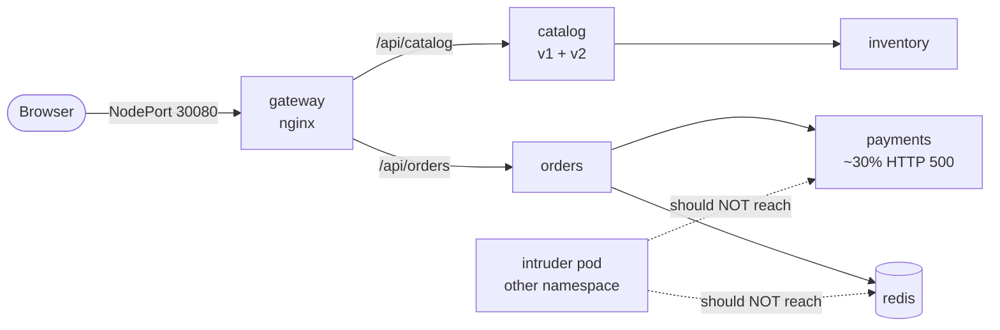

# MeshMart: Istio Practical Exam

> **Role:** Senior DevOps / Platform Engineer
> **Format:** take-home practical, about 3 hours (bonus tasks extra)
> **Environment:** your laptop (Rancher Desktop Kubernetes)

## The scenario

You have just joined the platform team at **MeshMart**, a small online shop running on Kubernetes.
Last week's security audit came back with two findings:

1. *"Any pod in the cluster can call any service, including payments and the datastore."*
2. *"Service-to-service traffic is unencrypted."*

On top of that, the product team wants to release a new **catalog v2** gradually, and on-call is tired of
customers seeing errors from the flaky **payments** service.

Your job is to bring MeshMart into an **Istio service mesh**, lock it down to zero-trust, and use the mesh for
safe releases and resilience. Then explain your decisions, as you would to the team.

---

## Architecture



| Workload | Image | ServiceAccount | Port | Notes |
|---|---|---|---|---|
| `gateway-v1` | nginx | `gateway` | 8080 (Service: 80, NodePort 30080) | Serves the UI and proxies `/api/*` |
| `catalog-v1`, `catalog-v2` | python | `catalog` | 8080 | One Service `catalog` selects both versions |
| `inventory-v1` | python | `inventory` | 8080 | Called by catalog |
| `orders-v1` | python | `orders` | 8080 | Calls payments, INCRs a counter in Redis |
| `payments-v1` | python | `payments` | 8080 | Fails ~30% of requests on purpose |
| `redis-v1` | redis | `redis` | 6379 (TCP) | Datastore |

Every backend runs the same tiny Python service (`chart/meshmart/files/app.py`, stdlib only) and answers with
JSON showing its name, version, pod, the result of each downstream call, and the caller's mesh identity
(`caller_identity`) when there is one.

The UI has four buttons. **Browse catalog** and **Place order** are the public API. **Inventory (direct)** and
**Payments (direct)** make the gateway call internal services that it should *not* be allowed to reach. They
exist so you can prove your lockdown works.

---

## Repository layout

```
.
├── README.md                    <- this file (the exam)
├── ANSWERS.md                   <- you fill this in
├── chart/meshmart/              <- Helm chart for the whole app
│   ├── values.yaml
│   ├── files/app.py             <- the backend service (do not modify)
│   ├── files/gateway/           <- nginx config + UI
│   └── templates/
├── istio/                       <- YOUR Istio manifests go here
├── platform/                    <- Istio install config + bonus observability values
└── tools/
    ├── intruder.yaml            <- a rogue pod in another namespace
    ├── load.sh                  <- traffic generator with status/version summary
    └── check.sh                 <- self-check for the final state
```

---

## Prerequisites

| Tool | Notes |
|---|---|
| **Rancher Desktop** | Kubernetes enabled (it runs k3s). In *Preferences → Virtual Machine* give it **4 CPUs and at least 6 GB RAM** (8 GB if you do the kube-prometheus-stack bonus). Either container engine works. |
| `kubectl` | Ships with Rancher Desktop. Check `kubectl config current-context` is `rancher-desktop`. |
| `helm` (v3) | Ships with Rancher Desktop, or `brew install helm`. |
| `istioctl` | Installed in Part 2 (download script below). |
| `curl`, `bash` | Already on macOS. |

Optional, bonus only: the `prometheus-community` Helm repo for kube-prometheus-stack.

> **Reaching the UI.** The gateway is a NodePort Service on **30080**, so try **http://localhost:30080** first;
> Rancher Desktop normally forwards NodePorts to localhost. If that doesn't load, fall back to
> `kubectl -n shop port-forward svc/gateway 8080:80` and use http://localhost:8080
> (then pass `BASE_URL=http://localhost:8080` to the scripts in `tools/`).
> Prefer the NodePort if you can: Part 4 behaves differently over port-forward, and question Q4.5 asks you why.

---

## Rules and deliverables

- Work on your own branch: `git checkout -b exam/<your-name>`. Commit at least once per Part.
- **Do not modify `chart/meshmart/files/app.py`.** Changing chart values or templates is allowed only if you
  justify it in `ANSWERS.md`. (None of the required tasks need it.)
- Every Istio resource you create lives in `istio/` as YAML, numbered in apply order. The reviewer will run
  `kubectl apply -f istio/` on a fresh cluster with MeshMart and Istio installed, so it must apply cleanly.
  Experiments that should **not** be part of the final state go in `istio/experiments/` (not applied, since
  `kubectl apply -f` is not recursive).
- Answer every **Q** and **W** question in `ANSWERS.md`. Short and precise beats long.
- Final state must pass `tools/check.sh`.
- Official docs (istio.io, kiali.io, kubernetes.io) are allowed. Hints at the bottom cost 2 points each;
  note in `ANSWERS.md` which ones you opened.

---

## Part 1: Baseline without Istio (10 pts)

Deploy MeshMart:

```bash
helm upgrade --install meshmart ./chart/meshmart -n shop --create-namespace
kubectl -n shop get pods -L app,version -w      # wait for 7 pods Running, 1/1
```

Open the UI, click every button and look at the JSON. Then deploy the intruder and generate some traffic:

```bash
kubectl apply -f tools/intruder.yaml

# Can a random pod in another namespace reach payments and the datastore?
kubectl -n intruder exec intruder -c shell -- curl -s -w '\nHTTP %{http_code}\n' http://payments.shop:8080/charge
kubectl -n intruder exec intruder -c shell -- sh -c "printf 'INCR hacked\r\n' | nc -w 2 redis.shop 6379"

tools/load.sh /api/catalog 50
tools/load.sh /api/orders 50
```

- **Q1.1** What split do you get between catalog v1 and v2, and what decides it? How would you send only 10% of
  traffic to v2 using plain Kubernetes, and what does that cost you?
- **Q1.2** What did the intruder tests show? Name a Kubernetes-native control that could block the intruder
  without a mesh, and two things it can't do that Istio can.
- **Q1.3** What is the orders failure rate? Without a mesh, where would retries for payments be implemented,
  and what's the downside of that across 50 microservices?

---

## Part 2: Install Istio and onboard MeshMart (15 pts)

Download Istio **outside this repo** (it brings `istioctl` and the sample addons you'll need in Part 3):

```bash
cd ~ && curl -L https://istio.io/downloadIstio | sh -
cd istio-*/ && export PATH="$PWD/bin:$PATH" && export ISTIO_HOME="$PWD"
cd -   # back to the repo
istioctl version
istioctl x precheck
```

Install the control plane with the laptop-sized config in this repo, then onboard the `shop` namespace:

```bash
istioctl install -f platform/istio-install.yaml -y
kubectl -n istio-system get pods

kubectl label namespace shop istio-injection=enabled
kubectl -n shop rollout restart deployment
kubectl -n shop get pods            # each pod should now report 2/2
```

Click through the UI again and repeat the intruder tests from Part 1.

- **Q2.1** List the containers *and* init containers of a catalog pod. What was added, by what mechanism, and
  without you changing the Helm chart? (If `istio-proxy` appears under init containers, explain why.)
- **Q2.2** Can the intruder still reach payments and Redis? Why? Is traffic between gateway and catalog
  encrypted right now? How can you tell?
- **Q2.3** Compare the `caller_identity` field in a catalog response now vs. Part 1. Where does that value come
  from, and what is its format?

---

## Part 3: Observability (10 pts)

Install the sample addons that ship with the Istio release (lab-quality, not for production):

```bash
kubectl apply -f "$ISTIO_HOME/samples/addons/prometheus.yaml"
kubectl apply -f "$ISTIO_HOME/samples/addons/grafana.yaml"
kubectl apply -f "$ISTIO_HOME/samples/addons/kiali.yaml"   # if this errors on first run, run it again
kubectl -n istio-system rollout status deploy/kiali

# keep some traffic flowing in another terminal
tools/load.sh /api/catalog 500 3 & tools/load.sh /api/orders 500 3 &

istioctl dashboard kiali      # opens http://localhost:20001
istioctl dashboard grafana    # Istio dashboards are preloaded under "istio"
```

In Kiali, open **Traffic Graph** for namespace `shop` (enable the *Security* display option), then
**Istio Config**. You'll come back to Istio Config after Parts 4 and 5 to see your own rules there.

- **Q3.1** Which edges in the graph show a padlock and which don't? Why is the traffic *entering* the gateway
  different from the rest?
- **Q3.2** What is the error rate of `payments` according to Kiali or Grafana? The app exports no metrics at all,
  so where do these numbers come from?

---

## Part 4: Zero trust (30 pts)

Required access matrix. Anything not listed must be denied.

| Source | May call |
|---|---|
| Browser (outside the mesh) | `gateway` on port 8080 |
| `gateway` | `catalog`, `orders` |
| `catalog` | `inventory` |
| `orders` | `payments`, `redis` |
| anything else (including the gateway's "direct" buttons and the intruder) | nothing |

### 4.1 Strict mTLS (8 pts)
Enforce **STRICT** mTLS for the `shop` namespace. The UI must keep working through the NodePort, and nothing
else in `shop` may accept plaintext. Prove that the un-meshed intruder can no longer reach payments or Redis.

- **Q4.1** What broke (if anything) when you first applied STRICT, why, and how did you fix it without
  weakening the rest of the namespace?

### 4.2 Least privilege with AuthorizationPolicies (12 pts)
Implement the matrix above with **default deny** plus explicit allows. Policies must be based on
**workload identity** (ServiceAccount principals), not IPs or labels of the caller. After this, the UI's
*Inventory (direct)* and *Payments (direct)* buttons must return **403**, while *Browse catalog* and
*Place order* still work.

- **Q4.2** Each workload in the chart has its own ServiceAccount. Why does that matter here, and what would
  happen if they all used `default`?

### 4.3 The intruder joins the mesh (5 pts)
```bash
kubectl label namespace intruder istio-injection=enabled
kubectl -n intruder delete pod intruder && kubectl apply -f tools/intruder.yaml
```
Repeat the intruder tests.

- **Q4.3** The intruder now has a valid mesh certificate. What error does it get now compared to 4.1, and
  which layer is blocking it in each case?

### 4.4 The datastore (5 pts)
The product team asks: *"orders should only be able to run `INCR` on Redis, never `FLUSHALL`."*

- **Q4.4** Can you enforce that with an Istio AuthorizationPolicy? Explain why or why not, and how you would
  meet the requirement instead.
- **Q4.5** Run `kubectl -n shop port-forward svc/payments 9000:8080` and `curl localhost:9000/charge`.
  Does it work despite your policies? Why? What does that tell you about who should get `pods/portforward`
  in RBAC?

---

## Part 5: Traffic management (25 pts)

### 5.1 Canary (8 pts)
Send **90%** of catalog traffic to v1 and **10%** to v2, without changing replica counts.

- **Q5.1** Which two Istio resources did you need, and what does each one do? Which pod's Envoy makes the
  routing decision for a request coming from the gateway?

### 5.2 Testers always get v2 (5 pts)
Requests with header `x-canary: always` must **always** hit catalog v2 (the UI has a checkbox for this),
while everyone else keeps the 90/10 split.

- **Q5.2** The header is set by the browser. Follow it hop by hop: why does it reach the place where routing
  happens, and what would happen to it on the *catalog → inventory* hop if `app.py` didn't propagate it?

### 5.3 Retries (6 pts)
Make **Place order** succeed at least 95% of the time **without touching payments**.

```bash
tools/load.sh /api/orders 100 5     # before and after
```

- **Q5.3** Where exactly did you configure retries, and on what conditions? Payments is a *charge* endpoint.
  What is the real-world danger of retrying it, and what must the service guarantee to make retries safe?

### 5.4 Timeouts and fault injection (6 pts)
1. Inject a fixed **4 second** delay into **100%** of requests to inventory. Click *Browse catalog* and note
   what happens.
2. Add a **1 second** timeout on calls to inventory so catalog fails fast.
3. Keep the timeout in `istio/` but move the fault injection to `istio/experiments/` (the final state must be
   healthy).

- **Q5.4** With both applied, what status does catalog report for its inventory call and how long does it
  take? Which Envoy applied the delay and which applied the timeout?

---

## Written questions (10 pts, 2 each)

- **W1** What are the roles of `istiod` and Envoy? If `istiod` is down for 10 minutes, what happens to
  existing traffic, to new pods, and to certificate rotation?
- **W2** You have 50 microservices in production in PERMISSIVE mode. Describe how you would migrate to STRICT
  without an outage, and what you'd watch while doing it.
- **W3** The gateway's nginx config sets `proxy_http_version 1.1`. Why does that matter once an Envoy sidecar
  sits next to nginx?
- **W4** What does the sidecar cost you (resources, latency, operations)? When would you advise **not**
  adopting a service mesh?
- **W5** In what order does Istio evaluate CUSTOM, DENY and ALLOW policies? If a workload has one ALLOW policy,
  what happens to a request that matches no rule?

---

## Bonus (up to +20)

Put bonus manifests in `istio/experiments/` or `platform/` and describe them in `ANSWERS.md`.

- **B1 Circuit breaking (+4).** Add connection-pool limits and outlier detection for payments. Trigger them with
  `tools/load.sh /api/orders 200 20` and find the evidence in the `istio-proxy` access log of the orders pod
  (look at the response flags). How do retries and circuit breaking interact?
- **B2 Production-style observability with your own Kiali (+5).** Replace the sample addons with
  kube-prometheus-stack plus Kiali, using the files in `platform/`:

  ```bash
  kubectl delete -f "$ISTIO_HOME/samples/addons" --ignore-not-found   # remove the Part 3 sample addons first
  helm repo add prometheus-community https://prometheus-community.github.io/helm-charts && helm repo update
  helm upgrade --install kps prometheus-community/kube-prometheus-stack \
    -n monitoring --create-namespace -f platform/kube-prometheus-stack-values.yaml
  kubectl apply -f platform/istio-prometheus-monitors.yaml
  kubectl -n monitoring get svc | grep prometheus      # confirm the URL used in kiali-values.yaml
  helm upgrade --install kiali-server kiali-server --repo https://kiali.org/helm-charts \
    -n istio-system -f platform/kiali-values.yaml
  kubectl -n istio-system port-forward svc/kiali 20001:20001        # http://localhost:20001
  kubectl -n monitoring port-forward svc/kps-grafana 3000:80        # http://localhost:3000 (admin/admin)
  ```

  In Grafana, import the Istio dashboards from grafana.com: **7639** (Mesh), **7636** (Service),
  **7630** (Workload) and **7645** (Control Plane). In Kiali, use **Istio Config** to review every policy you
  wrote and fix any validation warnings it shows. Explain why the PodMonitor relabels `__address__`.
- **B3 Istio ingress gateway (+4).** Replace the NodePort-on-nginx edge with an Istio ingress gateway
  (`Gateway` + `VirtualService`) in front of nginx. Note that Rancher Desktop's Traefik already holds ports
  80/443. What do you gain at the edge compared to Q4.1's fix?
- **B4 Distributed tracing (+4).** Wire up Jaeger and show one trace that spans gateway → orders → payments.
  Why does the app have to forward trace headers itself?
- **B5 Mirroring (+2).** Mirror 100% of catalog v1 traffic to v2 without users seeing v2 responses.
- **B6 Ambient mode (+1).** In a few sentences: how would your Part 4 and Part 5 config change in Istio
  ambient mode? Which of your policies would need a waypoint proxy, and why?

---

## Scoring

| Part | Points |
|---|---|
| 1. Baseline | 10 |
| 2. Onboarding | 15 |
| 3. Observability | 10 |
| 4. Zero trust | 30 |
| 5. Traffic management | 25 |
| Written | 10 |
| **Total** | **100** (+20 bonus) |

Reviewers look at: correctness (does `tools/check.sh` pass on a fresh cluster), least privilege (no
over-broad allows, no `*` principals where a specific one works), clarity of explanations, and clean,
reviewable YAML and commits.

---

## Useful commands

```bash
istioctl analyze -n shop                                  # config mistakes
istioctl x describe pod <pod> -n shop                     # which rules apply to a pod
istioctl proxy-config routes deploy/gateway-v1 -n shop    # what the gateway's Envoy will route
istioctl proxy-config cluster deploy/orders-v1 -n shop
kubectl -n shop logs deploy/orders-v1 -c istio-proxy --tail=20   # access log with response flags
kubectl get peerauthentication,authorizationpolicy,virtualservice,destinationrule -A
tools/check.sh                                            # self-check for the final state
```

## Cleanup

```bash
helm -n shop uninstall meshmart
kubectl delete namespace shop intruder
kubectl delete -f "$ISTIO_HOME/samples/addons" --ignore-not-found
helm -n istio-system uninstall kiali-server 2>/dev/null; helm -n monitoring uninstall kps 2>/dev/null
istioctl uninstall --purge -y && kubectl delete namespace istio-system monitoring --ignore-not-found
```

---

## Hints (2 points each, note which ones you opened)

<details><summary>H1: Part 4.1, the UI stopped working</summary>

The browser is not part of the mesh, so it can't present a client certificate. A `PeerAuthentication` can
target a single workload with a `selector`, and it can override the mode per port with `portLevelMtls`.
</details>

<details><summary>H2: Part 4.2, default deny</summary>

An `AuthorizationPolicy` with an empty `spec: {}` in a namespace denies all requests to workloads in that
namespace. Principals look like `cluster.local/ns/<namespace>/sa/<serviceaccount>` and only exist when the
caller connected over mTLS.
</details>

<details><summary>H3: Part 4.4, Redis</summary>

Istio only parses protocols it understands. For plain TCP, which fields of an AuthorizationPolicy rule can
it actually evaluate?
</details>

<details><summary>H4: Part 5, routing</summary>

Subsets are defined in a `DestinationRule` and select pods by label (the chart already sets `version`).
VirtualService routes are evaluated top to bottom, first match wins.
</details>
